# NOVA WORD — Especificación Técnica y Arquitectura de Datos (Mejoras v2.1)

> **Módulo:** Gestión Diaria, Auditoría Master, Asistente IA y Estructura Organizacional  
> **Organizaciones:** Elite Nutrition S.A.S. & Futupro  
> **Versión del Documento:** 2.1.0 (Arquitectura Técnica & Modelo Relacional)  
> **Estado:** Documentación Técnica Oficial Pre-Implementación  
> **Audiencia:** Desarrolladores Full-Stack, Ingenieros de Software, DBAs, DevOps y Auditores de Sistemas  

---

## 1. Visión General de la Arquitectura

Esta especificación detalla las modificaciones en el modelo de base de datos relacional (PostgreSQL / Supabase), reglas de seguridad a nivel de fila (Row Level Security - RLS), contratos de datos, algoritmos de cálculo de métricas e integración en el cliente frontend (Vue 3 / Vite) para dar soporte técnico a las mejoras operativas de la versión **2.1.0**.

```mermaid
graph TD
    subgraph FrontendVue3 ["💻 Capa de Cliente (Vue 3 / Vite)"]
        EW["EmployeeWorkspace.vue"]
        LD["LeaderDashboard.vue"]
        MD["MasterDashboard.vue"]
        TEM["TaskEvidenceModal.vue (Draft Cache)"]
        MC["MapaCargos.vue (Árbol Jerárquico)"]
        PDF["PDF Generator Service (Print & Canvas)"]
    end

    subgraph SupabaseBaaS ["🔒 Capa BaaS & Seguridad (Supabase / PostgreSQL)"]
        RTT["role_task_templates (times, evidence_req, sequence)"]
        TC["task_completions (audit logs)"]
        DC["daily_closings (cierres formales)"]
        EA["extraordinary_activities (aprobación líder/presidencia)"]
        STG["Storage: academy_videos & task_evidence"]
    end

    EW -->|Guarda borrador local| TEM
    EW -->|Lee tareas & marcas| RTT
    EW -->|Registra cumplimiento| TC
    EW -->|Cierra jornada & genera acta| DC
    EW -->|Genera reporte oficial| PDF
    EW -->|Registra imprevistos| EA
    LD -->|Audita fecha histórica| TC
    LD -->|Consulta cierres & KPIs| DC
    LD -->|Aprueba actividades| EA
    MC -->|Estructura por niveles 1..4| RTT
```



---

## 2. Modelo de Datos Relacional y Migración SQL

### 2.1. Alteraciones en Tablas Existentes

#### 1. Tabla `role_task_templates` (Memoria del Cargo)
Se amplía la tabla para soportar asignación de franja horaria, orden secuencial estricto y tipificación del requerimiento probatorio:

```sql
-- Franjas horarias de inicio y fin (formato HH:MI:SS)
ALTER TABLE role_task_templates 
ADD COLUMN IF NOT EXISTS start_time TIME WITHOUT TIME ZONE DEFAULT '08:00:00';

ALTER TABLE role_task_templates 
ADD COLUMN IF NOT EXISTS end_time TIME WITHOUT TIME ZONE DEFAULT '08:30:00';

-- Orden secuencial de ejecución en la jornada
ALTER TABLE role_task_templates 
ADD COLUMN IF NOT EXISTS sequence_order INT NOT NULL DEFAULT 1;

-- Nivel de exigencia probatoria
-- 'none': Check directo sin requisitos
-- 'text_only': Requiere resumen/métrica textual
-- 'photo_required': Requiere pantallazo/foto obligatoria
ALTER TABLE role_task_templates 
ADD COLUMN IF NOT EXISTS evidence_requirement VARCHAR(20) NOT NULL DEFAULT 'none';

DO $$
BEGIN
  ALTER TABLE role_task_templates DROP CONSTRAINT IF EXISTS role_task_templates_evidence_req_check;
  ALTER TABLE role_task_templates ADD CONSTRAINT role_task_templates_evidence_req_check 
    CHECK (evidence_requirement IN ('none', 'text_only', 'photo_required'));
EXCEPTION
  WHEN OTHERS THEN NULL;
END $$;

CREATE INDEX IF NOT EXISTS idx_role_task_templates_seq 
ON role_task_templates(role_id, sequence_order, start_time);
```

---

### 2.2. Nuevas Tablas del Sistema

#### 1. Tabla `daily_closings` (Consolidación y Cierre de Jornada Diaria)
Almacena el snapshot inmutable de cierre de la jornada por cada colaborador y fecha, sirviendo como fuente de verdad para la descarga de actas de cumplimiento y auditorías de jefatura:

```sql
CREATE TABLE IF NOT EXISTS daily_closings (
  id UUID PRIMARY KEY DEFAULT uuid_generate_v4(),
  profile_id UUID NOT NULL REFERENCES profiles(id) ON DELETE CASCADE,
  period_key VARCHAR(10) NOT NULL, -- Formato 'YYYY-MM-DD'
  total_tasks INT NOT NULL DEFAULT 0,
  completed_tasks INT NOT NULL DEFAULT 0,
  unfulfilled_tasks INT NOT NULL DEFAULT 0,
  extraordinary_tasks INT NOT NULL DEFAULT 0,
  compliance_percentage NUMERIC(5,2) NOT NULL DEFAULT 0.00,
  closed_at TIMESTAMPTZ NOT NULL DEFAULT NOW(),
  verification_hash TEXT, -- SHA-256 generado con profile_id + period_key + totals
  notes TEXT,
  status VARCHAR(20) NOT NULL DEFAULT 'closed' CHECK (status IN ('closed', 'certified', 'audited')),
  created_at TIMESTAMPTZ DEFAULT NOW(),
  updated_at TIMESTAMPTZ DEFAULT NOW(),
  UNIQUE(profile_id, period_key)
);

CREATE INDEX IF NOT EXISTS idx_daily_closings_profile_date 
ON daily_closings(profile_id, period_key);

CREATE INDEX IF NOT EXISTS idx_daily_closings_date 
ON daily_closings(period_key);
```

#### 2. Tabla `extraordinary_activities` (Actividades Fuera de Rutina con Aprobación)
Permite a los colaboradores registrar eventos, reuniones extraordinarias o tareas imprevistas asignadas por jefatura:

```sql
CREATE TABLE IF NOT EXISTS extraordinary_activities (
  id UUID PRIMARY KEY DEFAULT uuid_generate_v4(),
  profile_id UUID NOT NULL REFERENCES profiles(id) ON DELETE CASCADE,
  date DATE NOT NULL DEFAULT CURRENT_DATE,
  period_key VARCHAR(10) NOT NULL, -- 'YYYY-MM-DD'
  title TEXT NOT NULL,
  description TEXT NOT NULL,
  start_time TIME WITHOUT TIME ZONE NOT NULL,
  end_time TIME WITHOUT TIME ZONE NOT NULL,
  approver_type VARCHAR(20) NOT NULL CHECK (approver_type IN ('leader', 'presidency')),
  approver_id UUID REFERENCES profiles(id) ON DELETE SET NULL,
  evidence_text TEXT,
  evidence_photo TEXT,
  status VARCHAR(20) NOT NULL DEFAULT 'pending_approval' 
    CHECK (status IN ('pending_approval', 'approved', 'rejected')),
  rejection_reason TEXT,
  reviewed_at TIMESTAMPTZ,
  created_at TIMESTAMPTZ DEFAULT NOW(),
  updated_at TIMESTAMPTZ DEFAULT NOW()
);

CREATE INDEX IF NOT EXISTS idx_extraordinary_activities_profile 
ON extraordinary_activities(profile_id, period_key);

CREATE INDEX IF NOT EXISTS idx_extraordinary_activities_status 
ON extraordinary_activities(status, approver_type);
```

---

### 2.3. Políticas de Seguridad (Row Level Security - RLS)

```sql
-- 1. Habilitar RLS en nuevas tablas
ALTER TABLE daily_closings ENABLE ROW LEVEL SECURITY;
ALTER TABLE extraordinary_activities ENABLE ROW LEVEL SECURITY;

-- 2. Políticas para daily_closings
-- Lectura: El colaborador ve sus propios cierres; líderes ven su área; admins ven todo
DROP POLICY IF EXISTS "daily_closings_select_policy" ON daily_closings;
CREATE POLICY "daily_closings_select_policy" ON daily_closings
FOR SELECT TO authenticated
USING (
  auth.uid() = profile_id 
  OR public.is_master_admin() 
  OR (public.is_leader() AND profile_id IN (
    SELECT p.id FROM profiles p 
    JOIN roles r ON p.role_id = r.id 
    WHERE r.area_id = public.current_area_id()
  ))
);

-- Inserción / Cierre: Sólo el colaborador dueño o un Master Admin
DROP POLICY IF EXISTS "daily_closings_insert_policy" ON daily_closings;
CREATE POLICY "daily_closings_insert_policy" ON daily_closings
FOR INSERT TO authenticated
WITH CHECK (
  auth.uid() = profile_id 
  OR public.is_master_admin()
);

-- Actualización: No permitida por colaboradores una vez cerrada (inmutable); sólo Master Admin
DROP POLICY IF EXISTS "daily_closings_update_policy" ON daily_closings;
CREATE POLICY "daily_closings_update_policy" ON daily_closings
FOR UPDATE TO authenticated
USING (public.is_master_admin())
WITH CHECK (public.is_master_admin());

-- 3. Políticas para extraordinary_activities
-- Lectura: Colaborador ve las suyas; líderes ven las de su área; Master ve todas
DROP POLICY IF EXISTS "extraordinary_activities_select" ON extraordinary_activities;
CREATE POLICY "extraordinary_activities_select" ON extraordinary_activities
FOR SELECT TO authenticated
USING (
  auth.uid() = profile_id
  OR public.is_master_admin()
  OR (public.is_leader() AND approver_type = 'leader' AND profile_id IN (
    SELECT p.id FROM profiles p 
    JOIN roles r ON p.role_id = r.id 
    WHERE r.area_id = public.current_area_id()
  ))
);

-- Inserción: Colaborador autenticado para sí mismo
DROP POLICY IF EXISTS "extraordinary_activities_insert" ON extraordinary_activities;
CREATE POLICY "extraordinary_activities_insert" ON extraordinary_activities
FOR INSERT TO authenticated
WITH CHECK (auth.uid() = profile_id);

-- Actualización: Líderes aprueban las de su área; Master aprueba cualquier tipo
DROP POLICY IF EXISTS "extraordinary_activities_update" ON extraordinary_activities;
CREATE POLICY "extraordinary_activities_update" ON extraordinary_activities
FOR UPDATE TO authenticated
USING (
  public.is_master_admin()
  OR (public.is_leader() AND approver_type = 'leader' AND profile_id IN (
    SELECT p.id FROM profiles p 
    JOIN roles r ON p.role_id = r.id 
    WHERE r.area_id = public.current_area_id()
  ))
)
WITH CHECK (
  public.is_master_admin()
  OR (public.is_leader() AND approver_type = 'leader')
);
```

---

### 2.4. Garantía de Permisos en Nova Academy (Almacenamiento y Streaming de Videos)

Para solucionar de raíz el incidente de autorización reportado por los colaboradores al consultar videos:

```sql
-- Garantizar bucket público con políticas RLS de lectura transparentes
INSERT INTO storage.buckets (id, name, public, file_size_limit, allowed_mime_types)
VALUES (
  'academy_videos', 
  'academy_videos', 
  true, 
  524288000,
  ARRAY['video/mp4', 'video/webm', 'video/quicktime', 'video/x-m4v', 'image/jpeg', 'image/png', 'image/webp']
)
ON CONFLICT (id) DO UPDATE SET 
  public = true,
  file_size_limit = 524288000;

-- Lectura irrestricta para cualquier usuario autenticado o anónimo dentro de la intranet
DROP POLICY IF EXISTS "Permitir lectura de videos a usuarios autenticados" ON storage.objects;
CREATE POLICY "Permitir lectura de videos a usuarios autenticados"
  ON storage.objects FOR SELECT TO authenticated, anon
  USING (bucket_id = 'academy_videos');

-- Subida y gestión restringida a Administradores y Líderes con permiso can_manage_academy
DROP POLICY IF EXISTS "Permitir subida de videos solo a administradores" ON storage.objects;
CREATE POLICY "Permitir subida de videos solo a administradores"
  ON storage.objects FOR INSERT TO authenticated
  WITH CHECK (
    bucket_id = 'academy_videos' 
    AND (public.is_master_admin() OR public.can_manage_academy())
  );
```

---

## 3. Lógica de Frontend y Componentes

### 3.1. Control Estricto de la Ventana Temporal (00:01 a 23:59)

Se implementa en `EmployeeWorkspace.vue` un monitor de ciclo de jornada:

```javascript
// composable / función de ventana horaria en EmployeeWorkspace.vue
import { ref, onMounted, onUnmounted } from 'vue';

const isReadOnlyDay = ref(false);
const activePeriodKey = ref(getTodayPeriodKey());

function getTodayPeriodKey() {
  const now = new Date();
  return now.toISOString().split('T')[0];
}

// Verifica si la fecha consultada corresponde a un día cerrado (anterior)
function evaluateDateEditable(targetDateString) {
  const todayStr = getTodayPeriodKey();
  if (targetDateString < todayStr) {
    isReadOnlyDay.value = true;
  } else {
    isReadOnlyDay.value = false;
  }
}

// Watcher de corte automático de medianoche (00:00 -> 00:01)
let midnightCheckInterval = null;

onMounted(() => {
  midnightCheckInterval = setInterval(() => {
    const currentToday = getTodayPeriodKey();
    if (currentToday !== activePeriodKey.value) {
      // Cruzó la medianoche (23:59 -> 00:00 -> 00:01)
      console.warn('Corte de jornada detectado. Conmutando a nueva fecha de gestión:', currentToday);
      activePeriodKey.value = currentToday;
      // Recargar lista de tareas del nuevo día y congelar anterior
      loadDailyTasksForDate(currentToday);
    }
  }, 30000); // Comprobación periódica cada 30 segundos
});

onUnmounted(() => {
  if (midnightCheckInterval) clearInterval(midnightCheckInterval);
});
```

---

### 3.2. Persistencia Local de Borradores (Draft Cache) en `TaskEvidenceModal.vue`

Para eliminar la pérdida de información si el usuario cierra el modal involuntariamente:

```javascript
// Clave unívoca de almacenamiento local por usuario, tarea y fecha
function getDraftStorageKey(taskId, periodKey) {
  const userId = currentProfile.value?.id || 'anon';
  return `novawork_draft_${userId}_${taskId}_${periodKey}`;
}

// Guardado reactivo con debounce
function persistDraft() {
  if (!props.task?.id) return;
  const draftData = {
    selectedAction: selectedAction.value,
    evidenceText: evidenceText.value,
    evidencePhoto: evidencePhoto.value,
    cancellationReason: cancellationReason.value,
    updatedAt: Date.now()
  };
  localStorage.setItem(getDraftStorageKey(props.task.id, props.task.periodKey), JSON.stringify(draftData));
}

// Restauración automática al abrir el modal
function restoreDraftIfExists() {
  if (!props.task?.id) return;
  const rawDraft = localStorage.getItem(getDraftStorageKey(props.task.id, props.task.periodKey));
  if (rawDraft) {
    try {
      const parsed = JSON.parse(rawDraft);
      selectedAction.value = parsed.selectedAction || 'completed';
      evidenceText.value = parsed.evidenceText || '';
      evidencePhoto.value = parsed.evidencePhoto || '';
      cancellationReason.value = parsed.cancellationReason || '';
      hasRestoredDraft.value = true;
    } catch (e) {
      console.warn('Error restaurando borrador:', e);
    }
  }
}

// Purgado una vez enviado exitosamente a la base de datos
function clearDraft() {
  if (props.task?.id) {
    localStorage.removeItem(getDraftStorageKey(props.task.id, props.task.periodKey));
  }
}
```

---

### 3.3. Algoritmo de Bloqueo Secuencial Cronológico

Para asegurar que las actividades se desarrollen en el orden estratégico programado:

```javascript
/**
 * Determina si una tarea de la lista diaria está bloqueada por pre-requisito.
 * @param {number} taskIndex - Posición de la tarea en la lista ordenada cronológicamente
 * @param {Array} allDailyTasks - Lista de tareas del día ordenada por start_time y sequence_order
 * @returns {boolean} - true si está bloqueada, false si puede ejecutarse
 */
function isTaskBlocked(taskIndex, allDailyTasks) {
  // La primera tarea de la jornada nunca está bloqueada
  if (taskIndex === 0) return false;

  // Si la jornada está en modo histórico (solo lectura), todas quedan bloqueadas para edición
  if (isReadOnlyDay.value) return false; // En histórico solo se leen, no se bloquea la lectura

  // Verificar que TODAS las tareas previas hayan sido marcadas
  // ('completed' o 'unfulfilled')
  for (let i = 0; i < taskIndex; i++) {
    const prevTask = allDailyTasks[i];
    const isProcessed = prevTask.status === 'completed' || prevTask.status === 'unfulfilled';
    if (!isProcessed) {
      return true; // Existe al menos una tarea anterior sin procesar -> Bloquear
    }
  }

  return false;
}
```

---

### 3.4. Algoritmo de Métricas: Desacoplamiento de KPI Diario vs. Acumulado

#### Lógica de Cálculo en `LeaderDashboard.vue` y `PerformanceDashboard.vue`:

```javascript
// 1. KPI DIARIO (Para la fecha seleccionada 'selectedDay')
function computeDailyKpi(teamActivitiesForSelectedDay) {
  const dailyTasks = teamActivitiesForSelectedDay.filter(a => a.due_date === selectedDay.value);
  const total = dailyTasks.length;
  if (total === 0) return { count: 0, total: 0, percentage: 100 };

  const completed = dailyTasks.filter(a => a.status === 'completed').length;
  const percentage = Math.round((completed / total) * 1000) / 10; // 1 decimal

  return {
    completed,
    total,
    percentage // ej. 85.7%
  };
}

// 2. KPI ACUMULADO (A partir de los cierres históricos 'daily_closings' del período)
async function computeAccumulatedKpi(profileId, startDateStr, endDateStr) {
  const { data: closedDays, error } = await supabase
    .from('daily_closings')
    .select('compliance_percentage, period_key')
    .eq('profile_id', profileId)
    .gte('period_key', startDateStr)
    .lte('period_key', endDateStr);

  if (error || !closedDays || closedDays.length === 0) {
    return 100; // Valor neutro de inicio si no hay histórico cerrado
  }

  const sumPercentages = closedDays.reduce((acc, row) => acc + Number(row.compliance_percentage), 0);
  const accumulatedAverage = Math.round((sumPercentages / closedDays.length) * 10) / 10;

  return accumulatedAverage; // ej. 94.2%
}
```

---

### 3.5. Generador y Exportador de PDF de Verificación de Cumplimiento

Se implementa una vista imprimible estructurada con `@media print` de alta fidelidad, complementada con soporte de renderizado vectorizado:

```javascript
// Servicio de generación y descarga de acta en el cliente
export function exportCompliancePdf({ profile, periodKey, tasks, closingSummary }) {
  // Construye la ventana de impresión corporativa oficial
  const printWindow = window.open('', '_blank');
  const printHtml = `
    <!DOCTYPE html>
    <html lang="es">
    <head>
      <meta charset="UTF-8">
      <title>Acta de Cumplimiento - ${profile.full_name} (${periodKey})</title>
      <style>
        @page { size: letter portrait; margin: 12mm; }
        body { font-family: 'Segoe UI', Helvetica, Arial, sans-serif; color: #1d1d1f; font-size: 11px; margin: 0; }
        .header { display: flex; justify-content: space-between; border-bottom: 2px solid #0071e3; padding-bottom: 10px; margin-bottom: 15px; }
        .logo-box { font-size: 16px; font-weight: 800; color: #0071e3; letter-spacing: -0.5px; }
        .meta-table { width: 100%; border-collapse: collapse; margin-bottom: 15px; }
        .meta-table td { padding: 4px 6px; border: 1px solid #e5e5ea; font-size: 10px; }
        .kpi-banner { background: #f5f5f7; border-radius: 8px; padding: 10px; display: flex; justify-content: space-around; margin-bottom: 15px; }
        .kpi-item { text-align: center; }
        .kpi-val { font-size: 18px; font-weight: 800; color: #2e7d32; }
        .task-table { width: 100%; border-collapse: collapse; margin-bottom: 20px; }
        .task-table th { background: #f0f4ff; border: 1px solid #d2d2d7; padding: 6px; text-align: left; font-size: 10px; }
        .task-table td { border: 1px solid #e5e5ea; padding: 6px; vertical-align: top; }
        .evidence-thumb { max-width: 90px; max-height: 70px; border-radius: 4px; border: 1px solid #ccc; }
        .footer-sig { display: flex; justify-content: space-between; margin-top: 40px; }
        .sig-box { width: 42%; border-top: 1px solid #1d1d1f; text-align: center; padding-top: 5px; font-size: 10px; }
      </style>
    </head>
    <body>
      <div class="header">
        <div class="logo-box">ELITE NUTRITION S.A.S. / FUTUPRO<br><span style="font-size:10px; color:#666; font-weight:400;">SISTEMA OPERATIVO CORPORATIVO NOVA WORK</span></div>
        <div style="text-align:right; font-size:9px; color:#666;">
          <strong>ACTA OFICIAL DE CUMPLIMIENTO</strong><br>Fecha: ${periodKey}<br>Hash: ${closingSummary.verification_hash || 'VERIF-SYS-2026'}
        </div>
      </div>
      <!-- Resumen de Ficha y Métricas -->
      <table class="meta-table">
        <tr><td><strong>Colaborador:</strong> ${profile.full_name}</td><td><strong>Cargo:</strong> ${profile.roles?.name || 'N/A'}</td></tr>
        <tr><td><strong>Área:</strong> ${profile.roles?.areas?.name || 'Operaciones'}</td><td><strong>Hora de Cierre:</strong> ${new Date(closingSummary.closed_at).toLocaleTimeString()}</td></tr>
      </table>
      <div class="kpi-banner">
        <div class="kpi-item"><div>Total Tareas</div><div style="font-size:16px; font-weight:700;">${closingSummary.total_tasks}</div></div>
        <div class="kpi-item"><div>Completadas</div><div style="font-size:16px; font-weight:700; color:#2e7d32;">${closingSummary.completed_tasks}</div></div>
        <div class="kpi-item"><div>No Cumplidas</div><div style="font-size:16px; font-weight:700; color:#d32f2f;">${closingSummary.unfulfilled_tasks}</div></div>
        <div class="kpi-item"><div>% Efectividad</div><div class="kpi-val">${closingSummary.compliance_percentage}%</div></div>
      </div>
      <!-- Tabla de Tareas y Evidencias -->
      <table class="task-table">
        <thead>
          <tr><th style="width:12%;">Horario</th><th style="width:28%;">Actividad</th><th style="width:12%;">Estado</th><th style="width:32%;">Evidencia / Motivo</th><th style="width:16%;">Soporte</th></tr>
        </thead>
        <tbody>
          ${tasks.map(t => `
            <tr>
              <td>${t.start_time || '08:00'} - ${t.end_time || '08:30'}</td>
              <td><strong>${t.title}</strong></td>
              <td><span style="color:${t.status === 'completed' ? '#2e7d32' : '#d32f2f'}; font-weight:bold;">${t.status === 'completed' ? 'Realizado' : 'No Ejecutado'}</span></td>
              <td>${t.status === 'completed' ? (t.evidence_text || 'Completado conforme a protocolo') : (t.cancellation_reason || 'Sin justificación')}</td>
              <td>${t.evidence_photo ? `` : '<span style="color:#999; font-size:9px;">Sin foto adjunta</span>'}</td>
            </tr>
          `).join('')}
        </tbody>
      </table>
      <div class="footer-sig">
        <div class="sig-box">Firma del Colaborador<br><strong>${profile.full_name}</strong></div>
        <div class="sig-box">Visado de Jefatura Inmediata / Auditoría<br><strong>Dirección de Área</strong></div>
      </div>
    </body>
    </html>
  printWindow.document.write(printHtml);
  printWindow.document.close();
  printWindow.focus();
  setTimeout(() => { printWindow.print(); }, 500);
}
```

---

## 4. Script de Inicialización: Usuario Test Sandbox (`seed_test_sandbox_user.sql`)

```sql
-- ====================================================================
-- SEED: Usuario Test Sandbox para Validación de Flujos Operativos
-- ====================================================================

CREATE EXTENSION IF NOT EXISTS pgcrypto;

DO $$
DECLARE
  v_area_id UUID;
  v_role_id UUID;
  v_user_id UUID;
BEGIN
  -- 1. Obtener o crear Área de Sistemas/Operaciones
  SELECT id INTO v_area_id FROM areas WHERE name ILIKE '%Sistemas%' OR name ILIKE '%Operaciones%' LIMIT 1;
  IF v_area_id IS NULL THEN
    INSERT INTO areas (id, name, description)
    VALUES (gen_random_uuid(), 'Auditoría y Sistemas', 'Área técnica para pruebas y control de calidad')
    RETURNING id INTO v_area_id;
  END IF;

  -- 2. Crear Cargo de Prueba (la tabla roles usa 'objective', no 'description')
  SELECT id INTO v_role_id FROM roles WHERE name = 'Analista de Pruebas Sandbox' LIMIT 1;
  IF v_role_id IS NULL THEN
    INSERT INTO roles (id, name, area_id, access_level, objective)
    VALUES (gen_random_uuid(), 'Analista de Pruebas Sandbox', v_area_id, 3, 'Cargo de homologación para validar mejoras operativas')
    RETURNING id INTO v_role_id;
  END IF;

  -- 3. Sembrar Plantillas de Tareas Diarias con Horarios Secuenciales
  DELETE FROM role_task_templates WHERE role_id = v_role_id;

  INSERT INTO role_task_templates 
    (role_id, title, description, frequency, priority, start_time, end_time, sequence_order, evidence_requirement)
  VALUES
    (v_role_id, '1. Inspección de Puesto y Apertura de Terminales', 'Verificar conectividad a internet y encendido de periféricos', 'daily', 'medium', '06:10', '06:30', 1, 'none'),
    (v_role_id, '2. Verificación de Inventario de Despachos en Bodega', 'Cruzar planillas de pedidos con existencias físicas', 'daily', 'high', '06:30', '08:00', 2, 'photo_required'),
    (v_role_id, '3. Conciliación y Registro de Planillas de Facturación', 'Digitar guías despachadas en el sistema contable', 'daily', 'high', '08:00', '10:00', 3, 'text_only'),
    (v_role_id, '4. Auditoría de Calidad y Atención de Novedades', 'Revisar reclamos de clientes y roturas en empaque', 'daily', 'medium', '10:00', '12:00', 4, 'photo_required'),
    (v_role_id, '5. Cierre Operativo y Entrega de Turno', 'Asegurar instalaciones, apagado de máquinas y reporte a líder', 'daily', 'high', '12:00', '13:00', 5, 'none');

  -- 4. Usuario en auth.users y profiles
  SELECT id INTO v_user_id FROM auth.users WHERE email = 'test.operativo@elitenutrition.com' LIMIT 1;
  
  IF v_user_id IS NULL THEN
    BEGIN
      INSERT INTO auth.users (
        instance_id,
        id,
        aud,
        role,
        email,
        encrypted_password,
        email_confirmed_at,
        raw_app_meta_data,
        raw_user_meta_data,
        created_at,
        updated_at
      ) VALUES (
        '00000000-0000-0000-0000-000000000000',
        gen_random_uuid(),
        'authenticated',
        'authenticated',
        'test.operativo@elitenutrition.com',
        crypt('Pruebas2026*', gen_salt('bf')),
        NOW(),
        '{"provider":"email","providers":["email"]}',
        '{"full_name":"Usuario de Pruebas Sandbox"}',
        NOW(),
        NOW()
      ) RETURNING id INTO v_user_id;
    EXCEPTION WHEN OTHERS THEN
      v_user_id := NULL;
    END;
  END IF;

  IF v_user_id IS NOT NULL THEN
    INSERT INTO profiles (id, full_name, role_id, is_master_admin, can_manage_academy, approval_status)
    VALUES (
      v_user_id,
      'Usuario de Pruebas Sandbox',
      v_role_id,
      false,
      true,
      'approved'
    )
    ON CONFLICT (id) DO UPDATE SET 
      full_name = 'Usuario de Pruebas Sandbox',
      role_id = v_role_id,
      approval_status = 'approved';
  END IF;

END $$;
```

---

## 5. Reorganización de MapaCargos.vue (Organigrama por Áreas y Niveles)

En `MapaCargos.vue`, los roles se categorizan de forma matemática según su `access_level`:

```javascript
// Agrupación en 4 Niveles Oficiales de Gobernanza
const level1Roles = computed(() => roles.value.filter(r => r.access_level === 1)); // Presidencia & Dirección
const level2Roles = computed(() => roles.value.filter(r => r.access_level === 2)); // Gerencias de Área
const level3Roles = computed(() => roles.value.filter(r => r.access_level === 3)); // Líderes & Analistas
const level4Roles = computed(() => roles.value.filter(r => r.access_level >= 4));  // Auxiliares & Operativos

// Agrupación por Área Organizacional con sus respectivos sub-niveles
const hierarchyByArea = computed(() => {
  const result = {};
  areas.value.forEach(area => {
    result[area.name] = {
      gerentes: roles.value.filter(r => r.area_id === area.id && r.access_level === 2),
      lideresYAnalistas: roles.value.filter(r => r.area_id === area.id && r.access_level === 3),
      operativos: roles.value.filter(r => r.area_id === area.id && r.access_level >= 4)
    };
  });
  return result;
});
```

---

## 6. Lista de Archivos y Componentes a Intervenir en la Implementación

| Componente / Archivo | Tipo | Naturaleza del Cambio |
| :--- | :--- | :--- |
| `database/daily_management_v2_migration.sql` | SQL | Nueva migración con campos `start_time`, `end_time`, `evidence_requirement`, tablas `daily_closings` y `extraordinary_activities`, y RLS. |
| `database/seed_test_sandbox_user.sql` | SQL | Inserción del usuario test sandbox y sus plantillas de prueba. |
| `frontend/src/views/EmployeeWorkspace.vue` | Vue | Selector de fecha histórico, bloqueo de edición < hoy, corte medianoche 00:01, botón cerrar jornada y exportar PDF, bloqueo secuencial. |
| `frontend/src/components/TaskEvidenceModal.vue` | Vue | Persistencia de borrador (draft cache), flexibilización de evidencia obligatoria según `evidence_requirement`, diálogo ante cierre. |
| `frontend/src/views/LeaderDashboard.vue` | Vue | Selector de fecha calendario para auditoría de evidencia histórica, corrección de fórmula de KPI Diario vs Acumulado, bandeja de aprobación extraordinaria. |
| `frontend/src/views/MasterDashboard.vue` | Vue | Auditoría global histórica y consola de supervisión de cierres. |
| `frontend/src/views/MapaCargos.vue` | Vue | Reestructuración de visualización arbórea por Área y 4 Niveles jerárquicos. |
| `frontend/src/views/OracleView.vue` y Navbars | Vue / UI | Rebranding completo de "Oráculo IA" a "Asistente IA". |
| `frontend/src/views/AcademiaElite.vue` | Vue | Solución de permisos y streaming para videos de Nova Academy. |
