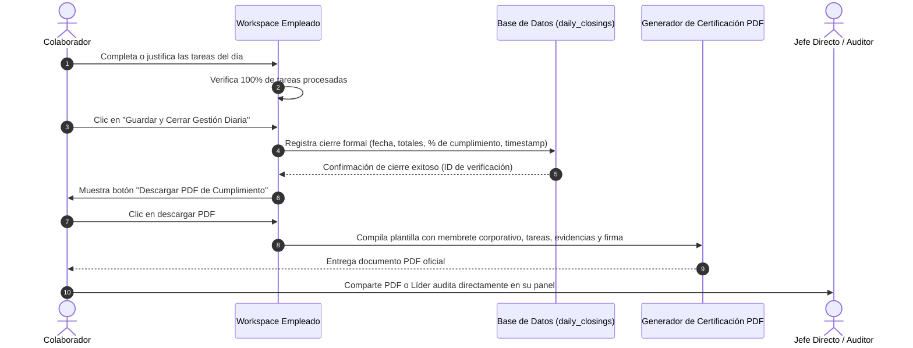
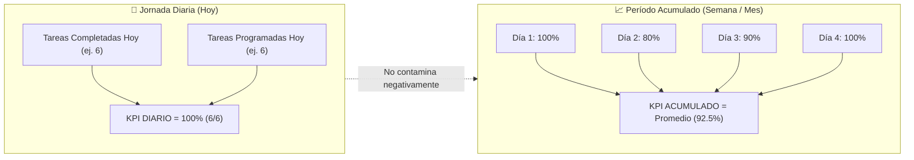
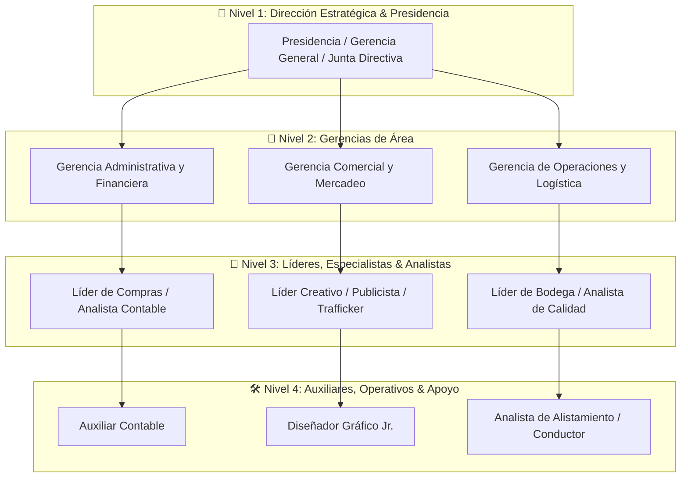

# NOVA WORD — Especificación Funcional y de Usabilidad (Mejoras v2.1)

> **Módulo:** Gestión Diaria, Auditoría Master, Asistente IA y Estructura Organizacional  
> **Organizaciones:** Elite Nutrition S.A.S. & Futupro  
> **Versión del Documento:** 2.1.0 (Planificación & Especificación Funcional)  
> **Estado:** Documentación Oficial Pre-Implementación  
> **Audiencia:** Usuarios Finales (Colaboradores), Líderes de Área, Auditores, Master Admin y Diseñadores de Producto  

---

## 1. Resumen Ejecutivo de las Mejoras

Este documento define en detalle los requisitos de producto, experiencia de usuario (UX/UI), reglas de negocio, flujos operativos y pantallas para la evolución integral de **NOVA WORD**, abordando las necesidades operativas identificadas en dos dominios centrales:

1. **Experiencia del Colaborador (USUARIO):**
   - Consulta histórica de gestiones previas en modo de sólo lectura con descarga de soportes.
   - Cierre formal de la jornada diaria y generación/descarga de un **PDF de Verificación de Cumplimiento** para auditoría de jefatura.
   - Ventana horaria inquebrantable de jornada: de `00:01` a `23:59` con cierre automatizado de corte diario.
   - Persistencia automática de borradores en tareas para impedir pérdidas de datos ante cierres involuntarios de ventana.
   - Flexibilización y clasificación inteligente del requerimiento de evidencias (sólo obligatoria en tareas críticas).
   - Corrección integral de permisos y visualización de contenidos audiovisuales en **Nova Academy**.

2. **Experiencia de Jefatura y Auditoría (MASTER / LÍDER):**
   - Auditoría histórica por fecha de calendario para verificar datos y evidencias reales de cualquier jornada.
   - Reingeniería del motor de métricas: separación estricta entre **KPI Diario** (exacto y no retroactivo) y **KPI Acumulado** (% ponderado del período).
   - Bloqueo secuencial estratégico: avance obligatorio en orden cronológico paso a paso.
   - Rebranding corporativo: cambio oficial de **"Oráculo IA"** a **"Asistente IA"**.
   - Habilitación de un **Usuario Test Sandbox** para validación continua de flujos.
   - Reorganización estructural del **Organigrama** por áreas y niveles jerárquicos oficiales (Nivel 1 al 4).
   - Programación de tareas con franja horaria específica (ej. `06:10 - 06:30`).
   - Botón y flujo de **"Actividad Extraordinaria"** no mapeada con circuito de aprobación por Líder o Presidencia.

---

## 2. Especificación Funcional — Módulo de Usuario (Colaborador)

### 2.1. Historial de Gestiones Diarias (Solo Lectura) y Descarga de Archivo

#### Propósito y Problema Resuelto
Anteriormente, el colaborador sólo disponía del día en curso o existía riesgo de que alterara gestiones de fechas anteriores. Con esta mejora, el usuario puede inspeccionar cualquier día previo para validar qué entregó, pero con bloqueo total de edición.

#### Comportamiento de la Interfaz
1. **Selector de Fecha en el Workspace:**
   - Se ubica en la cabecera de `EmployeeWorkspace.vue` junto a la fecha del día.
   - Permite seleccionar días anteriores mediante un picker o botones rápidos de navegación (`< Ayer`, `Hoy`).
2. **Modo Consulta Histórica (Solo Lectura):**
   - Si la fecha seleccionada es menor a la fecha actual (`selectedDate < today`):
     - Se despliega un banner informativo superior:
       > 🔒 **Gestión Histórica Cerrada (Solo Lectura):** Estás visualizando la gestión del día **[DD/MM/AAAA]**. Esta jornada se encuentra finalizada y no admite modificaciones.
     - Todas las casillas de verificación (checkboxes) y botones de acción quedan **inhabilitados (disabled)**.
     - Al hacer clic sobre cualquier tarea se abre el modal en modo visualización de evidencia (inspección de foto ampliada, texto de evidencia o motivo de no cumplimiento).
3. **Botón de Descarga del Día:**
   - Botón visible en cabecera: **"Descargar Archivo del Día"** (icono `file_download`).
   - Descarga un archivo con el resumen consolidado de esa fecha (disponible en formato PDF oficial y opción de exportación CSV/JSON).

---

### 2.2. Guardado Integral y Descarga del PDF de Verificación de Cumplimiento

#### Propósito y Flujo Operativo
El colaborador necesita una constancia física o digital que certifique ante su jefe directo que cumplió a cabalidad su labor del día.

#### Estructura del PDF de Verificación de Cumplimiento
El documento generado contiene:
- **Encabezado Corporativo Oficial:** Logotipo de Elite Nutrition / Futupro, NIT, título *"Acta Individual de Verificación y Cumplimiento de Gestión Diaria"*.
- **Ficha del Colaborador:** Nombre completo, cédula/identificación, cargo, área corporativa, nombre del líder directo asignado.
- **Datos de la Jornada:** Fecha de gestión, hora de inicio de la primera actividad, hora de cierre formal, total de horas cubiertas.
- **Cuadro Resumen de Indicadores:**
  - Total de tareas programadas.
  - Tareas completadas exitosamente.
  - Tareas no ejecutadas (con causa justificada).
  - Actividades extraordinarias aprobadas.
  - **Índice de Cumplimiento Diario:** `X%` (con código de semáforo: Verde $\ge 90\%$, Amarillo $70-89\%$, Rojo $<70\%$).
- **Bitácora Detallada de Actividades:**
  - Tabla con: Franja Horaria (`06:10 - 06:30`), Nombre de la Tarea, Estado (`Realizado` / `No Ejecutado`), Resumen de Evidencia, Miniatura fotográfica probatoria y Código único de registro.
- **Pie de Certificación:** Hash alfanumérico de seguridad (SHA-256 de verificación), fecha y hora exacta del sistema, espacio para firma del colaborador y firma/visado de jefatura.

---

### 2.3. Ventana Horaria Inquebrantable de Jornada (00:01 a 23:59)

#### Regla de Negocio
- Cada gestión diaria corresponde estrictamente al período de **00:01:00** a **23:59:59** de la fecha del servidor/zona horaria oficial (Colombia / America/Bogota).
- **Caso Especial (Sesión nocturna / Ventana abierta desde el día anterior):**
  - Si un colaborador deja su navegador abierto durante la noche y el reloj sobrepasa las `23:59:59`:
    1. A las `00:00` el sistema congela la jornada anterior y activa el estado de cierre automático.
    2. A las `00:01` el sistema conmuta la vista automáticamente a la nueva fecha calendario del día.
    3. Se muestra un modal suave de transición:
       > 🌅 **Inicio de Nueva Jornada:** Ha finalizado la jornada del día de ayer. Tus registros han sido asegurados. Se ha inicializado tu lista de tareas para hoy.
    4. Esto evita que tareas realizadas en la madrugada se imputen a la fecha incorrecta o sobreescriban gestiones del día pasado.

---

### 2.4. Persistencia de Borradores en Tareas (Draft Auto-Save)

#### Problema Detectado
Si el colaborador abre la ventana para cargar una evidencia, redacta un texto largo o selecciona una foto, y accidentalmente cierra la ventana modal o se desconecta la red, el formulario se reiniciaba borrando su progreso.

#### Comportamiento Nuevo
1. **Auto-Guardado en Tiempo Real (Draft Cache):**
   - Cada pulsación de teclado en el campo de texto y cada foto cargada se almacena inmediatamente en el almacenamiento local seguro (`localStorage` con clave indexada por `userId_taskId_date`).
2. **Restauración Automática:**
   - Al volver a abrir la tarea, el sistema restaura el texto y la fotografía previamente cargada, mostrando un aviso sutil: *"Borrador recuperado automáticamente"*.
3. **Diálogo de Protección ante Cierre Accidental:**
   - Si el usuario hace clic en el botón de cerrar (`X`) o fuera del modal teniendo datos sin enviar, el sistema consulta:
     - **"¿Deseas conservar tu borrador o descartarlo?"**
     - Opciones: `[Guardar Borrador y Salir]` | `[Descartar Datos]` | `[Continuar Editando]`.
4. **Liberación del Borrador:**
   - El borrador sólo se purga cuando el usuario hace clic en **"Confirmar y Enviar Tarea"** y la base de datos responde con éxito (HTTP 200/201).

---

### 2.5. Clasificación Inteligente de Evidencia (Sólo lo Relevante)

#### Criterio Operativo
No todas las tareas del día justifican un pantallazo o una foto. Exigir foto en tareas rutinarias (como *"Revisión de correo institucional"*) genera fricción y fatiga operativa.

#### Niveles de Exigencia por Plantilla de Tarea
En la memoria del cargo (`role_task_templates`), cada tarea cuenta con un nivel de evidencia definido por la dirección:

| Nivel de Evidencia | Etiqueta en UI | Exigencia para el Colaborador | Casos de Uso Típicos |
| :--- | :--- | :--- | :--- |
| `none` (Básica) | *Check Directo* | Se marca con 1 solo clic. Foto y texto son completamente opcionales. | Pausas activas, lectura de anuncios, apertura de herramientas. |
| `text_only` (Operativa) | *Nota Requerida* | Requiere redactar un texto breve, enlace o métrica numérica. Foto opcional. | Resumen de llamadas atendidas, reporte verbal, actualización de CRM. |
| `photo_required` (Crítica / Estratégica) | *Evidencia Obligatoria 📷* | Requiere obligatoriamente pantallazo/foto y descripción justificada. | Arqueos de caja, inventarios físicos, despachos de pedidos, firma de contratos, informes contables. |

---

### 2.6. Resolución de Acceso a Videos en Nova Academy

#### Problema Detectado
El usuario colaborador recibía alertas de *"No tiene autorización del video"* o ventanas bloqueadas al intentar reproducir capacitaciones en Nova Academy.

#### Solución Funcional
1. **Videos de Infraestructura Microsoft 365 (SharePoint / OneDrive / Stream):**
   - Se incorpora un comprobador preventivo de enlace. Si el enlace es de SharePoint/OneDrive, la interfaz muestra las directrices de visualización corporativa y el botón de autenticación única (Single Sign-On).
   - Enlace directo a abrir en pestaña corporativa con credenciales institucionales de Futupro / Elite Nutrition.
2. **Videos Nativos en Almacenamiento NOVA (.MP4 / WebM):**
   - Los videos subidos directamente por administradores en la plataforma quedan respaldados en el bucket dedicado con permisos de lectura pública/autenticada y generación transparente de enlaces de transmisión (streaming URL), garantizando que cualquier colaborador activo pueda reproducirlos sin restricciones de permisos.
3. **Indicador de Estado de Conectividad:**
   - Si el video experimenta bloqueo por políticas de firewall de la red o token vencido, la interfaz muestra un botón alternativo: **"Reproducir en Ventana Segura"** y **"Descargar Material de Apoyo"**.

---

## 3. Especificación Funcional — Módulo Master / Líder (Jefatura y Auditoría)

### 3.1. Auditoría de Cualquier Fecha de Calendario

#### Propósito y Funcionalidad
El Master Admin y los Líderes de Área deben contar con la potestad de auditar el desempeño histórico de cualquier fecha anterior sin limitaciones.

#### Componente en Pantalla
1. **Barra de Navegación Temporal de Auditoría (`LeaderDashboard.vue` / `MasterDashboard.vue`):**
   - Calendario interactivo desplegable que permite seleccionar año, mes y día exacto.
   - Selector de colaborador del equipo o vista global de área.
2. **Visualización de la Jornada Auditada:**
   - Estado general del colaborador ese día: `Gestión Cerrada` (con hora exacta) o `Gestión Incompleta/No Cerrada`.
   - Listado de tareas con la foto de evidencia original en alta resolución (con zoom y visor modal).
   - Timestamp exacto de cuándo se ejecutó cada actividad (`14:22:15`).
   - Justificaciones de las tareas no ejecutadas.
3. **Descarga de Acta de Auditoría:**
   - Botón para que el líder descargue el reporte consolidado del equipo para esa fecha en formato PDF o Excel.

---

### 3.2. Reingeniería de Indicadores: KPI Diario vs. KPI Acumulado

#### Problema Detectado
Los indicadores anteriores mezclaban tareas históricas no realizadas con la gestión de hoy, arruinando los promedios e impidiendo que una persona con tareas viejas pudiera tener un día con 100% de cumplimiento.

#### Nuevo Modelo de Métricas
El sistema implementa dos indicadores independientes y complementarios:

#### Reglas de Presentación
1. **Tarjeta 1: KPI Diario (Efectividad de la Jornada):**
   - Muestra el valor numérico absoluto y el porcentaje del día seleccionado:  
     $$\text{KPI Diario} = \frac{\text{Tareas Completadas del Día}}{\text{Tareas Programadas del Día}} \times 100\%$$
   - Ejemplo visual: **`6 / 7 Tareas (85.7%)`**.
   - Si una tarea del día anterior no se realizó, **no penaliza** el KPI diario de hoy. El día anterior quedó cerrado con su respectivo porcentaje.
2. **Tarjeta 2: KPI Acumulado (Consistente del Período):**
   - Refleja el promedio matemático de los porcentajes diarios cerrados a lo largo del período seleccionado (Semanal o Mensual):  
     $$\text{KPI Acumulado} = \frac{\sum_{i=1}^{N} \text{KPI Diario}_i}{N}$$
   - Permite al líder evaluar la constancia del colaborador sin que un mal día pasado destruya para siempre el indicador diario actual.

---

### 3.3. Orden Estratégico y Bloqueo Secuencial Cronológico

#### Regla de Dependencia Operativa
Las tareas del cargo están diseñadas bajo un orden lógico operacional. Un colaborador no debe saltarse tareas preparatorias para ejecutar tareas avanzadas.

#### Comportamiento en la Interfaz
1. **Orden Cronológico Estricto:**
   - La lista de tareas se ordena ascendentemente por su franja horaria de inicio (`start_time`).
2. **Bloqueo Secuencial:**
   - La tarea `N` permanece **bloqueada** (con icono de candado 🔒 y opacidad reducida) hasta que la tarea `N-1` haya sido marcada (bien sea como `Realizado` con su evidencia, o como `No se pudo ejecutar` con su debida justificación).
3. **Mensaje de Interacción:**
   - Si el usuario intenta hacer clic sobre una tarea bloqueada, el sistema emite un aviso didáctico:
     > 🔒 **Actividad Bloqueada:** Debes completar o justificar primero la actividad previa: **[06:10 - 06:30] Alistamiento de Puesto de Trabajo**.
4. **Excepción Supervisada:**
   - Los usuarios con rol Master Admin o Líder de Área cuentan con un botón de desbloqueo de emergencia en caso de que una tarea se encuentre detenida por contingencias de fuerza mayor.

---

### 3.4. Rebranding: "Oráculo IA" pasa a ser "Asistente IA"

#### Alcance del Cambio
Se sustituye toda la terminología en interfaces, títulos, botones, rutas de navegación, diálogos y notificaciones:

| Término Anterior | Nuevo Término Oficial | Ubicación en el Sistema |
| :--- | :--- | :--- |
| *Oráculo IA* | **Asistente IA** | Barra de navegación superior (GlobalNavbar), botón de acceso directo. |
| *El Oráculo Enterprise* | **Asistente IA Corporativo** | Cabecera principal de `OracleView.vue`. |
| *Hablar con Oráculo* | **Consultar Asistente IA** | Tarjetas de recomendación en Dashboards de Liderazgo. |
| *Dictamen del Oráculo* | **Análisis del Asistente IA** | Drawer de procesos en `MiroProcessMap.vue`. |
| *Cartografiar con Oráculo* | **Generar con Asistente IA** | Mapeador automático de flujos y manuales de cargo. |

---

### 3.5. Usuario Test Sandbox para Pruebas y Validación

#### Especificación del Entorno de Pruebas
Para garantizar que cualquier modificación pueda ser validada sin poner en riesgo registros laborales reales, se institucionaliza un usuario sandbox:

- **Nombre:** Usuario de Pruebas Sandbox
- **Correo Institucional:** `test.operativo@elitenutrition.com`
- **Cargo:** Analista de Control y Pruebas Operativas
- **Área:** Calidad y Auditoría de Sistemas
- **Nivel Jerárquico:** Nivel 3 (Acceso a Workspace de Empleado y Módulos de Prueba)
- **Datos Precargados:**
  - 5 tareas diarias con franjas horarias cronológicas consecutivas (`06:10` a `17:00`).
  - Tareas con requerimiento mixto de evidencia (`none`, `text_only`, `photo_required`).
  - Historial de 3 días previos cerrados para probar consulta histórica y descarga de PDF.

---

### 3.6. Estructuración Jerárquica del Organigrama por Área y Nivel

#### Arquitectura de Niveles Organizacionales
En la vista de `MapaCargos.vue`, la jerarquía se clasifica formalmente en cuatro niveles estructurados:

#### Filtros y Visualización
- **Filtro Primario por Área:** Operaciones, Comercial, Finanzas, Gestión Humana, Sistemas.
- **Filtro Secundario por Nivel Jerárquico:** Nivel 1 (Dirección), Nivel 2 (Gerencias), Nivel 3 (Especialistas), Nivel 4 (Operativos).
- **Tarjetas de Cargo Enriquecidas:** Cada nodo muestra el nombre del cargo, área, nivel, cantidad de personas activas y botón de acceso a la memoria de tareas del cargo.

---

### 3.7. Asignación Horaria Específica por Tarea (Time Slots)

#### Especificación
Cada tarea dentro de la rutina diaria cuenta con un bloque temporal definido:
- **Hora Inicio (`start_time`):** Hora en formato 24h (ej. `06:10`).
- **Hora Fin (`end_time`):** Hora en formato 24h (ej. `06:30`).
- **Duración Estimada:** Cálculo automático en minutos (ej. `20 min`).

#### Estados Visuales de la Tarea en el Timeline
- 🟢 **En curso:** Hora actual del sistema se encuentra dentro de la franja `[start_time, end_time]`.
- ⚪ **Próxima:** Franja horaria posterior a la hora actual.
- 🟡 **Completada a tiempo:** Realizada dentro de su franja o jornada.
- 🔴 **Retrasada:** La hora actual sobrepasó `end_time` y la tarea sigue pendiente de ejecución.

---

### 3.8. Módulo de "Actividades Extraordinarias" con Aprobación Jerárquica

#### Justificación Operativa
En la operación diaria surgen contingencias, reuniones de urgencia o instrucciones directas de presidencia que no están mapeadas en la rutina base del cargo. El colaborador debe poder registrarlas para que no se interprete que estuvo inactivo durante ese tiempo.

#### Flujo de Solicitud y Aprobación
1. **Botón en Workspace:** Botón destacado **"+ Registrar Actividad Extraordinaria"** (icono `emergency` o `add_task`).
2. **Formulario de Registro:**
   - **Título de la actividad:** (ej. *"Reunión extraordinaria de fijación de precios"*).
   - **Descripción detallada:** Explicación del trabajo efectuado.
   - **Franja horaria ocupada:** Hora inicio y hora fin.
   - **Autorizador / Aprobador:** Selector con dos opciones:
     - `Líder de Área Directo`
     - `Presidencia / Gerencia General`
   - **Soporte / Evidencia:** Adjunto de imagen o documento opcional.
3. **Bandeja de Aprobación para Jefatura:**
   - En el panel del Líder y de Presidencia aparece la pestaña **"Actividades Extraordinarias Pendientes"**.
   - Opciones con 1 clic: `[Aprobar Actividad]` | `[Rechazar con Observación]`.
4. **Impacto en el Cumplimiento:**
   - Una vez aprobada, la actividad se integra a la bitácora del día del colaborador y se suma como actividad válida realizada, reflejándose en el PDF de verificación de cumplimiento.

---

## 4. Matriz de Roles y Permisos para las Nuevas Funcionalidades

| Funcionalidad | Colaborador (Nivel 3-4) | Líder de Área (Nivel 2) | Master Admin / Presidencia (Nivel 1) |
| :--- | :---: | :---: | :---: |
| Ver gestión de días anteriores (Solo Lectura) | ✅ Propia | ✅ De su equipo | ✅ De toda la empresa |
| Descargar PDF de cumplimiento diario | ✅ Propio | ✅ De su equipo | ✅ De toda la empresa |
| Guardar y cerrar gestión del día | ✅ Propia | ❌ (Solo el colaborador) | ✅ (Modo contingencia) |
| Registrar Actividad Extraordinaria | ✅ Sí | ✅ Sí | ✅ Sí |
| Aprobar Actividades Extraordinarias | ❌ No | ✅ De su equipo | ✅ De toda la empresa |
| Auditar fecha histórica en calendario | ❌ No | ✅ Su área | ✅ Total |
| Modificar franjas horarias de plantillas | ❌ No | ✅ Su área | ✅ Total |
| Desbloquear tareas secuenciales | ❌ No | ✅ Su área | ✅ Total |
| Ver videos de Nova Academy | ✅ Acceso total | ✅ Acceso total | ✅ Acceso total + Admin |

---

## 5. Criterios de Aceptación Funcional

1. **CA-01 (Histórico Inmutable):** El usuario no puede marcar, desmarcar ni modificar ninguna tarea perteneciente a fechas anteriores. Los botones de guardado quedan bloqueados.
2. **CA-02 (PDF Descargable):** El PDF de cumplimiento se descarga inmediatamente al hacer clic, con diseño corporativo nítido, sin errores de renderizado y con todas las firmas y marcas de tiempo correctas.
3. **CA-03 (Ventana 00:01 - 23:59):** Una sesión que cruce la medianoche es detectada automáticamente sin pérdida de información, cerrando la jornada previa e iniciando la nueva.
4. **CA-04 (Borrador Inmune):** Al cerrar accidentalmente la ventana modal de una tarea con texto y foto, y volverla a abrir, los datos deben estar intactos sin necesidad de volver a cargarlos.
5. **CA-05 (KPI Independiente):** Un colaborador con tareas omitidas en días pasados que hoy cumpla sus 5 tareas asignadas debe registrar exactamente un **100% de KPI Diario**.
6. **CA-06 (Secuencia Bloqueante):** El botón de marcar la Tarea 2 está inhabilitado hasta que la Tarea 1 sea confirmada como realizada o con motivo de no cumplimiento.
7. **CA-07 (Asistente IA):** En ninguna pantalla del sistema debe figurar visible la palabra "Oráculo IA", habiendo sido reemplazada completamente por "Asistente IA".
8. **CA-08 (Actividad Extraordinaria):** Una actividad extraordinaria no aprobada figura como pendiente y no suma al KPI hasta que el líder o presidencia marque "Aprobado".
