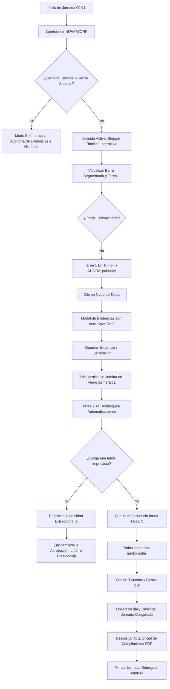

# Documento Especial de Mejoras Visuales, UX/UI y Operatividad V2.2
## NOVA WORK · PROMETHEUS OS | Elite Nutrition Group

---

### Control de Emisión del Documento
- **Sistema:** NOVA WORK · PROMETHEUS OS
- **Organización:** Elite Nutrition Group / Holding
- **Versión:** 2.2.0 (Build Producción Vercel)
- **Tipo de Documento:** Especificación Visual, Guía de Experiencia de Usuario (UX/UI) y Manual de Adopción
- **Fecha de Publicación:** 23 de Octubre de 2026
- **Estado:** Implementado, Verificado y Desplegado en Producción
- **Archivos de Código Impactados:**
  - `frontend/src/views/EmployeeWorkspace.vue`
  - `frontend/src/components/TaskEvidenceModal.vue`
  - `frontend/src/views/MapaCargos.vue`
  - `frontend/src/components/GlobalNavbar.vue`
  - `frontend/src/views/OracleView.vue`
  - `frontend/src/views/MiroProcessMap.vue`
  - `frontend/src/views/MasterDashboard.vue`
  - `database/daily_management_v2_migration.sql`

---

## 1. Resumen Ejecutivo de la Transformación

La actualización V2.2 de **NOVA WORK** transforma radicalmente el espacio de trabajo del colaborador y el centro de auditoría de los líderes. Se pasó de una lista vertical estática y genérica de pendientes a un **Sistema Operativo Visual de Gestión y Gobernanza en Tiempo Real**, caracterizado por:

1. **Flujo Guiado y Secuencial:** El colaborador ya no se dispersa; el sistema ilumina su camino actividad por actividad.
2. **Estética Apple-Grade / Modern Glassmorphism:** Interfaz limpia con acabados en vidrio esmerilado (*Frosted Glass*), micro-animaciones hápticas y degradados armónicos.
3. **Resiliencia Operativa:** Cero pérdida de información gracias al guardado automático de borradores en memoria local.
4. **Verificabilidad Legal e Institucional:** Descarga instantánea de un **Acta Oficial de Cumplimiento en PDF** con validez ante jefatura y auditoría.
5. **Rebranding y Claridad Conceptual:** Adopción oficial del término **"Asistente IA"** y visualización formal de la estructura corporativa en **4 Niveles Jerárquicos**.

---

## 2. Las 8 Grandes Innovaciones Visuales y de UX

```
┌─────────────────────────────────────────────────────────────────────────────┐
│                       NOVA WORK V2.2 — EXPERIENCIA VISUAL                   │
├─────────────────────────────────────────────────────────────────────────────┤
│  [1] Stepper Timeline Cronológico Interactivo con Riel Conector              │
│  [2] Barra de Progreso Segmentada de la Jornada (Stories Style)             │
│  [3] Tarjetas Frosted Glass (Vidrio Esmerilado) en Tareas Bloqueadas        │
│  [4] Monitor de Horario en Vivo ("● AHORA" con pulso dinámico)              │
│  [5] Selector Histórico de Jornadas & Modo Auditoría Solo Lectura           │
│  [6] Modal de Evidencia con Auto-Save y Detección de Requisitos Flexibles   │
│  [7] Generador de Acta Oficial de Verificación de Cumplimiento (PDF)        │
│  [8] Organigrama Corporativo de 4 Niveles Oficiales y Asistente IA          │
└─────────────────────────────────────────────────────────────────────────────┘
```

---

### Innovación 1: Stepper Timeline Cronológico Interactivo con Riel Iluminado

#### Problema Anterior:
Las actividades aparecían como un listado plano de casillas de verificación (checkboxes), sin noción de precedencia temporal ni ritmo de ejecución.

#### Solución Visual Implementada:
- **Riel Conector Vertical (`Stepper Rail`):** Una línea vertical continua une cada actividad con la siguiente. A medida que las actividades se completan, el riel se ilumina en color verde esmeralda sólido (`#34c759`). Si la actividad posterior está bloqueada, el riel pasa a ser punteado sutil (`border-dashed border-gray-200`).
- **Nodos Circulares Inteligentes:**
  - **Completada:** Círculo verde esmeralda con checkmark blanco y sombra tridimensional suave (`shadow-[0_4px_12px_rgba(52,199,89,0.35)]`).
  - **En Turno (Turno Actual):** Círculo blanco con borde azul `#0071e3`, aro exterior pulsante (`ring-4 ring-[#0071e3]/20 animate-pulse`) e icono de reproducción (`play_arrow`).
  - **Bloqueada por Secuencia:** Círculo neutro con candado de seguridad (`lock`), impidiendo el salto no autorizado.
  - **No Ejecutada (Justificada):** Círculo carmesí (`#ff3b30`) con cruz blanca (`close`) y registro visible del motivo.

---

### Innovación 2: Barra de Progreso Segmentada de la Jornada

#### Descripción Visual:
En la cabecera de la Gestión Diaria se implementó un indicador horizontal segmentado (inspirado en la telemetría aeroespacial y las historias de redes modernas). Cada actividad representa una ranura proporcional:
- **Verde Esmeralda:** Tarea cumplida con evidencia validada.
- **Rojo Carmesí:** Tarea no ejecutada con justificación registrada.
- **Azul Pulsante:** Tarea activa en curso que requiere la atención del usuario en este momento.
- **Gris Claro:** Tareas futuras aún bloqueadas.

A la derecha se visualiza el ritmo en vivo: **`4 de 7 completadas (57%)`**, ofreciendo una lectura instantánea sin necesidad de recorrer todo el scroll de la página.

---

### Innovación 3: Tarjetas con Estilo *Frosted Glass* en Tareas Bloqueadas

#### Descripción Visual:
Para garantizar el principio de **orden estratégico cronológico** sin generar frustración visual:
- Las tareas bloqueadas aplican un filtro CSS de **vidrio esmerilado translúcido**:
  ```css
  bg-white/50 backdrop-blur-md border border-dashed border-gray-300/80 opacity-70 cursor-not-allowed select-none
  ```
- La tarjeta atenúa los textos y desactiva el cursor de clic.
- Si el colaborador intenta interactuar con ella, el sistema le muestra un mensaje claro e instructivo:
  > *"Esta actividad está bloqueada. Debes completar o justificar primero las actividades previas en el orden cronológico."*

---

### Innovación 4: Monitor de Franja Horaria en Vivo (*Live Time Slot Indicator*)

#### Lógica y Visualización:
- Cada actividad template cuenta con franja horaria formal (ej: `08:00 - 08:30`, `08:30 - 09:30`).
- El componente evalúa en tiempo real (`isCurrentTimeSlot`) los minutos transcurridos del día del usuario contra el horario de la tarea.
- Si la hora del reloj coincide con la tarea:
  - La píldora horaria se pinta de **azul rey corporativo (`#0071e3`)** con texto blanco.
  - Se añade un badge enérgico: **`● AHORA`** con animación de respiración / pulso.
- Si la tarea es futura, se muestra en azul pastel sutil (`bg-blue-50 text-[#0071e3]`).

---

### Innovación 5: Selector Histórico de Jornadas & Modo Auditoría Solo Lectura

#### Componentes de la Barra Superior:
```
┌─────────────────────────────────────────────────────────────────────────────────────────┐
│ 📅 Jornada: [<] [ 2026-10-22 ] [>] [Hoy]        🔒 Jornada Cerrada (Solo Lectura)       │
├─────────────────────────────────────────────────────────────────────────────────────────┤
│ [+ Actividad Extraordinaria]                  [📄 Descargar Acta PDF] [💾 Guardar Día]  │
└─────────────────────────────────────────────────────────────────────────────────────────┘
```

- **Navegación Intuitiva:** Flechas de retroceso y avance con bloqueo estricto de fechas futuras.
- **Modo Histórico (Solo Lectura):** Al consultar cualquier día anterior o un día ya consolidado, los botones de acción se deshabilitan o se transforman en botones de inspección, impidiendo adulteraciones retrospectivas de evidencias.
- **Corte de Medianoche (00:01 a 23:59):** Un temporizador en segundo plano detecta el paso a las 00:01, congela la jornada anterior y refresca automáticamente la vista para iniciar el nuevo ciclo diario.

---

### Innovación 6: Modal de Evidencias con Auto-Save y Drafts Resilientes

#### Experiencia del Colaborador en `TaskEvidenceModal.vue`:
1. **Auto-Guardado Local (Draft Resilient):**
   - Mientras el usuario redacta su justificación o selecciona archivos, cada tecla se sincroniza automáticamente en `localStorage` bajo la clave `novawork_draft_{taskId}_{periodKey}`.
   - Si el modal se cierra accidentalmente (por clic fuera, recarga de página o corte de luz), al reabrirlo aparece un **banner ámbar interactivo**:
     > *"Borrador recuperado automáticamente. Hemos restaurado el texto que estabas escribiendo."*
   - Cuenta con botón para **"Descartar borrador"** si el usuario prefiere comenzar de nuevo.
2. **Requisitos Dinámicos de Evidencia:**
   - **`photo_required`:** Exige fotografía obligatoria antes de habilitar el botón de envío.
   - **`text_only`:** Exige justificación escrita o soporte numérico.
   - **`none` (Rutinaria):** Permite confirmación ágil con un solo clic, sin obligar al usuario a tomar capturas innecesarias.

---

### Innovación 7: Generador de Acta Oficial de Verificación de Cumplimiento (PDF)

#### Características del Documento Generado:
Al presionar **"Descargar Acta PDF"**, el sistema genera dinámicamente un documento estructurado de alta gerencia, listo para archivar o imprimir:
- **Encabezado Institucional:** Identificación oficial de *ELITE NUTRITION GROUP - NOVA WORK*.
- **Metadatos de Trazabilidad:** Nombre completo del colaborador, cargo, área, fecha de la jornada, hora exacta de emisión y código único de auditoría (`ID Auditoría`).
- **Métrica de Cumplimiento:** Porcentaje del KPI obtenido y conteo de actividades (`ej: 100% - 7/7`).
- **Tabla Cronológica Oficial:**
  | # | Horario | Actividad Asignada | Estado | Evidencia / Justificación | Hora Reg. |
  | :-: | :-: | :-- | :-: | :-- | :-: |
- **Espacio Legal de Validación:** Firmas estandarizadas para el **Colaborador** y para la **Jefatura Inmediata / Auditoría**.

---

### Innovación 8: Estructura Corporativa de 4 Niveles y Rebranding Asistente IA

#### 4 Niveles Jerárquicos en el Organigrama (`MapaCargos.vue`):
1. **Nivel 1 — Dirección Ejecutiva:** Presidencia, Dirección General, Holding (Nodos Dorados).
2. **Nivel 2 — Gerencia / Líder de Área:** Cabezas de departamento con acceso a paneles de liderazgo (Nodos Azules).
3. **Nivel 3 — Coordinación / Especialista:** Mandos medios y supervisores operativos (Nodos Púrpura).
4. **Nivel 4 — Operativo / Asistencia:** Cargos tácticos y asistenciales de ejecución continua (Nodos Esmeralda con borde dashed de soporte).

#### Rebranding Integral:
- Sustitución formal del término **"Oráculo IA"** por **"Asistente IA"** en:
  - Barra de navegación principal (`GlobalNavbar.vue`).
  - Menú responsive móvil.
  - Centro de Conocimiento y Consultoría (`OracleView.vue`).
  - Lienzo de Cartografía de Procesos (`MiroProcessMap.vue`).
  - Tablero de Control Maestro (`MasterDashboard.vue`).

---

## 3. Diagrama de Flujo: Recorrido del Usuario en la Jornada



---

## 4. Matriz Comparativa: Antes vs. Después

| Característica / Experiencia | Antes (V2.1) | Ahora (V2.2 - Experiencia Premium) |
| :--- | :--- | :--- |
| **Diseño de Tareas Diarias** | Lista plana vertical de checkboxes estándar. | **Stepper Timeline Interactivo** con riel conector iluminado y nodos dinámicos. |
| **Control de Secuencia** | El usuario podía marcar cualquier tarea en desorden. | **Bloqueo Secuencial Cronológico** con estética *Frosted Glass* y candado háptico. |
| **Ritmo de Jornada** | Sin indicador visual global de avance diario. | **Barra Segmentada (Stories-Style)** en cabecera con % de avance en vivo. |
| **Conciencia Temporal** | Textos estáticos de horario sin referencia en vivo. | **Monitor en tiempo real** que resalta la tarea en curso con etiqueta **"● AHORA"**. |
| **Seguridad de Datos en Evidencias** | Si el modal se cerraba sin guardar, el texto se perdía. | **Draft Auto-Save**: borrador local persistente con banner interactivo de restauración. |
| **Exigencia de Evidencias** | Se solicitaba foto y texto a todas las actividades por igual. | **Diferenciación Inteligente**: `photo_required`, `text_only` o `none` (rutinaria). |
| **Auditoría de Días Anteriores** | Imposible ver el estado de días previos sin tocar base de datos. | **Selector Histórico de Fechas** con visualización completa en solo lectura. |
| **Cierre y Verificación para Jefes** | No existía comprobante formal de cumplimiento diario. | **Acta Oficial en PDF** lista para imprimir con firmas de colaborador y auditor. |
| **Actividades no Planificadas** | No había cómo reportar reuniones imprevistas o urgencias. | **Módulo "+ Actividad Extraordinaria"** con aprobación de Líder o Presidencia. |
| **Organigrama Corporativo** | Limitado a 3 niveles sin reflejo de la base operativa. | **4 Niveles Jerárquicos Oficiales** (Dirección, Líder, Especialista, Operativo). |
| **Nomenclatura de Inteligencia** | Denominado "Oráculo IA". | Estandarizado oficialmente como **"Asistente IA"**. |

---

## 5. Instrucciones de Adopción para Equipos Operativos y Auditores

### Para el Colaborador Operativo:
1. Inicie su sesión cada mañana en su espacio de trabajo. Verifique que la barra superior indique **"Jornada Activa (00:01 - 23:59)"**.
2. Identifique el nodo que tiene el indicador **"En Turno"** o **"● AHORA"**.
3. Haga clic sobre la tarjeta para abrir el modal. Si la tarea requiere foto, adjúntela; si es rutinaria, confírmela con un solo clic.
4. Si por alguna eventualidad no puede realizar una tarea, selecciónela y marque **"No pude cumplir con la actividad"**, explicando la razón justificable. Esto desbloqueará la tarea siguiente sin detener su jornada.
5. Al finalizar su última actividad del día, presione **"Guardar y Cerrar Día"** y luego **"Descargar Acta PDF"** para archivar o remitir a su supervisor.

### Para el Líder de Área y Auditor:
1. Para auditar el cumplimiento de cualquier colaborador, utilice el selector de fechas para trasladarse al día exacto deseado.
2. Revise las evidencias fotográficas y soportes adjuntos directamente en pantalla sin alterar los registros históricos.
3. Solicite al colaborador el **Acta Oficial de Cumplimiento en PDF** como soporte documental para revisiones de rendimiento periódicas.

---

### Registro de Aprobación
- **Elaborado por:** Equipo de Arquitectura de Software & Diseño UX/UI (NOVA WORK)
- **Revisado por:** Dirección de Tecnología y Operaciones
- **Aprobado para Producción:** Elite Nutrition Group / Holding
- **Vigencia:** A partir del ciclo operativo Octubre 2026
